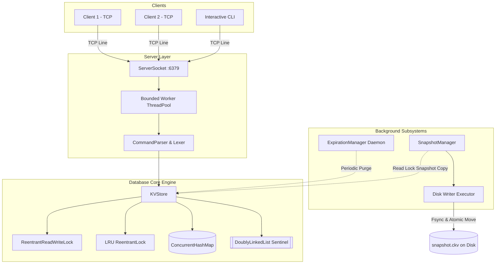
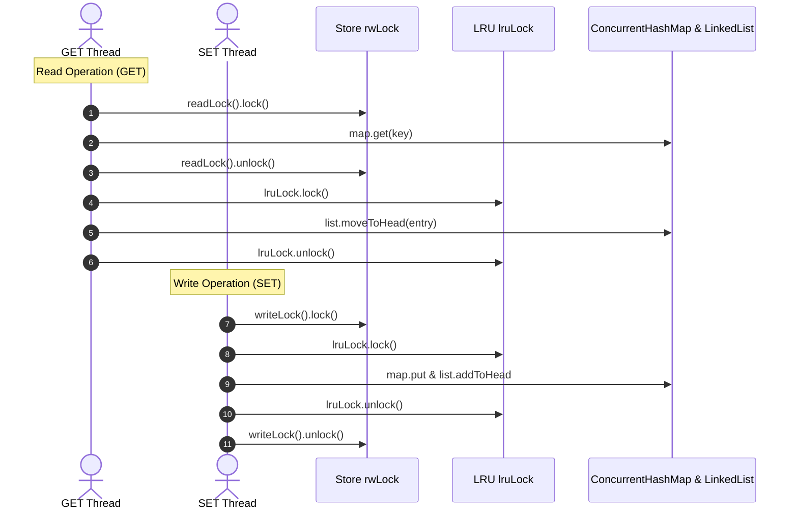

# ConcurrentKVStore

A production-grade, lightweight, Redis-inspired concurrent in-memory key-value database built from scratch in Java.

Designed for high-throughput concurrency, deterministic thread safety, $O(1)$ LRU cache eviction, hybrid monotonic TTL expiration, crash-resilient atomic disk persistence, and a multi-client TCP network protocol.

---

## 1. Problem Statement & Objectives

Modern cloud architectures and high-scale backends rely on in-memory data stores (like Redis and Memcached) to achieve sub-millisecond data retrieval. However, implementing an in-memory database from scratch requires solving several non-trivial systems problems:
1. **Thread Safety without Global Bottlenecks**: Allowing concurrent readers without race conditions while ensuring atomic mutations for compound updates.
2. **LRU Cache Recency Tracking**: Maintaining strict $O(1)$ access recency across multiple threads without corrupting doubly linked list pointers.
3. **Monotonic Key Expiration**: Accurately expiring keys without vulnerability to NTP wall-clock jumps, while maintaining lazy and active cleanup.
4. **Crash-Resilient Persistence**: Creating point-in-time disk snapshots without blocking ongoing client reads and writes, while guaranteeing file atomicity.
5. **Robust Network Protocol**: Serving multiple concurrent TCP socket clients using a bounded thread pool and a clean text protocol.

**ConcurrentKVStore** was built to solve these challenges without external libraries, using core Java concurrency primitives.

---

## 2. Key Features

- **Core Key-Value Operations**: `SET`, `GET`, `DEL`, `EXISTS`, `KEYS`, `DBSIZE`, `FLUSHALL`, `PING`, `INFO`, `SAVE`.
- **Deterministic Two-Level Concurrency**: Coordinated `ReentrantReadWriteLock` for store access and a dedicated `ReentrantLock` for LRU list mutations.
- **$O(1)$ LRU Cache Eviction**: Configurable maximum key capacity with custom Doubly-Linked List and sentinel nodes.
- **Dual-Phase TTL Expiration**:
  - *Passive (Lazy) Expiration*: Instantaneous monotonic evaluation on read access (`System.nanoTime()`).
  - *Active (Periodic) Cleanup*: Background sampling on a daemon `ScheduledExecutorService`.
- **Atomic Binary Snapshot Persistence**:
  - Point-in-time snapshot capture under a brief read lock.
  - Background asynchronous disk serialization.
  - CRC32 integrity checksum and hardware flush (`fsync`).
  - Atomic rename (`Files.move` with `ATOMIC_MOVE`) to prevent partial/corrupt snapshots.
- **Multi-Client TCP Server**: Bounded `ThreadPoolExecutor` with connection limit enforcement and line-length security guards.
- **Interactive CLI & Programmatic Client**: Line-based protocol with quoted string support and automatic escape sequences.
- **100% Automated Test Coverage**: 35 JUnit 5 tests covering concurrent race conditions, LRU order, TTL expiration, snapshot recovery, and TCP socket lifecycle.

---

## 3. Technology Stack

- **Language**: Java 17+ (Compiled and tested on Java 25 LTS).
- **Networking**: Java TCP Sockets (`ServerSocket`, `Socket`).
- **Concurrency**: `ConcurrentHashMap`, `ReentrantReadWriteLock`, `ReentrantLock`, `ThreadPoolExecutor`, `ScheduledExecutorService`, `CountDownLatch`, `AtomicLong`.
- **Data Structures**: Custom Doubly-Linked List with sentinel nodes, Hash Map indexing.
- **Persistence & I/O**: Java File I/O, `DataOutputStream`, `DataInputStream`, `CheckedOutputStream`, `CRC32`, `fsync`.
- **Testing**: JUnit 5 Jupiter (`@Test`, `@BeforeEach`, `@AfterEach`, `@DisplayName`).
- **Build Tool**: Apache Maven (includes cross-platform wrapper `mvnw.cmd` and `mvnw`).

---

## 4. System Architecture



---

## 5. Concurrency Model & Locking Strategy

### Why `ConcurrentHashMap` alone is not enough for an LRU Cache
`ConcurrentHashMap` guarantees thread-safe read/write operations for individual map buckets. However, an LRU cache requires **compound operations across two distinct data structures**:
1. The hash table for $O(1)$ key lookup.
2. The doubly linked list for maintaining access recency.

If multiple threads execute `GET` concurrently, both threads attempt to move their node to the head of the linked list. Without synchronization, updating `node.prev` and `node.next` pointers leads to race conditions, detached nodes, circular pointers, and memory leaks.

### Two-Level Locking Hierarchy
To maximize read concurrency while guaranteeing consistency:

1. **Store Lock (`ReentrantReadWriteLock rwLock`)**:
   - Multiple threads can acquire `readLock()` simultaneously for non-structural operations: `EXISTS`, `PTTL`, `KEYS`, `DBSIZE`, and `captureSnapshotEntries()`.
   - Modifying operations (`SET`, `DEL`, `FLUSHALL`) acquire `writeLock()`.
   - Configured with `fair = true` to prevent writer starvation.
2. **LRU Lock (`ReentrantLock lruLock`)**:
   - A fine-grained lock guarding pointer modifications in `DoublyLinkedList`.
   - `GET` operations acquire `rwLock.readLock()`, look up the entry, and briefly acquire `lruLock` to move the node to the head. This allows dozens of threads to perform concurrent reads without blocking each other on the primary store lock.



### Deadlock Prevention Guarantee
> **Lock Acquisition Rule**: Any thread that requires both locks must ALWAYS acquire `rwLock` FIRST, and `lruLock` SECOND. Because the lock acquisition order is strictly monotonic, deadlocks are mathematically impossible.

---

## 6. Supported Protocol Commands

| Command | Arguments | Description | Example Response |
|---|---|---|---|
| `SET` | `key value [ttl]` | Inserts or updates key with optional TTL (seconds) | `OK` |
| `GET` | `key` | Retrieves the stored value (updates LRU recency) | `VALUE Alice` or `(nil)` |
| `DEL` | `key` | Deletes a key from the database | `(integer) 1` or `(integer) 0` |
| `TTL` | `key seconds` | Sets or updates expiration time in seconds | `(integer) 1` |
| `PTTL` | `key` | Returns remaining TTL in milliseconds | `(integer) 4500` (-1=no ttl, -2=missing) |
| `EXISTS` | `key` | Checks if a key exists and is non-expired | `(integer) 1` or `(integer) 0` |
| `KEYS` | *none* | Lists all active non-expired keys | `1) "user:1"` |
| `DBSIZE` | *none* | Returns the number of active keys | `(integer) 12` |
| `FLUSHALL` | *none* | Clears all keys and resets LRU cache | `OK` |
| `PING` | `[message]` | Tests server connectivity | `PONG` or `<message>` |
| `SAVE` | *none* | Triggers immediate snapshot persistence | `OK snapshot saved` |
| `INFO` | *none* | Displays server and database statistics | Multi-line metrics |
| `QUIT` | *none* | Closes the client connection | `OK bye` |

---

## 7. Snapshot Persistence & Durability Analysis

### The `.ckv` Binary Format
Snapshots use an object-independent binary format:
```
[MAGIC: 'CKVS' (4B)] [VERSION: 1 (4B)] [TIMESTAMP (8B)] [COUNT (4B)]
[RECORDS: KeyLen(4B) + KeyBytes + ValLen(4B) + ValBytes + HasExpiry(1B) + ExpiryEpoch(8B)...]
[CRC32 CHECKSUM (8B)]
```

### Crash-Resilient Atomic Write Process
1. **Snapshot Copy**: KVStore takes a quick read lock, extracts live non-expired entries in LRU order, and releases the read lock immediately.
2. **Background Serialization**: Records are streamed into a unique temporary file (`snapshot.ckv.tmp.<UUID>`) while calculating a 32-bit CRC.
3. **Hardware Synchronization**: Calls `FileDescriptor.sync()` (`fsync`) to flush all OS kernel file buffers to physical storage.
4. **Atomic Rename**: Replaces `snapshot.ckv` via `Files.move(..., ATOMIC_MOVE, REPLACE_EXISTING)`. If power is lost mid-write, the existing snapshot remains uncorrupted.

### Durability Guarantees vs. Write-Ahead-Log (WAL)
- **Durability Model**: Snapshot-only persistence (identical to Redis RDB mode).
- **RPO (Recovery Point Objective)**: Up to the configured snapshot interval (e.g., 60 seconds).
- **Trade-Off**: Writes achieve in-memory speeds (> 100,000 ops/sec). In the event of an abrupt process kill or power loss, writes made after the last snapshot are not preserved.

---

## 8. Build, Test & Run Guide (Windows & Cross-Platform)

### Prerequisites
- **Java**: JDK 17 or higher (Verified on JDK 25 LTS).
- **Maven**: Included via `./mvnw` (Linux/macOS) and `.\mvnw.cmd` (Windows).

### 1. Compile the Project
```powershell
.\mvnw.cmd compile
```

### 2. Run All Automated Tests
```powershell
.\mvnw.cmd test
```

### 3. Package Executable JAR
```powershell
.\mvnw.cmd package
```
Generates `target/concurrent-kv-store-1.0.0.jar`.

### 4. Start the Server
```powershell
java -jar target/concurrent-kv-store-1.0.0.jar
```
Options supported:
- `--port=6380` (default: 6379)
- `--host=0.0.0.0` (default: 127.0.0.1)
- `--max-keys=5000` (default: 1000)
- `--data-dir=./my-data` (default: ./data)
- `--snapshot-interval=30` (default: 60 seconds)

### 5. Launch the Interactive CLI Client
Open a second terminal window:
```powershell
java -jar target/concurrent-kv-store-1.0.0.jar client
```
Or specify host and port:
```powershell
java -jar target/concurrent-kv-store-1.0.0.jar client 127.0.0.1 6379
```

---

## 9. Example Terminal Session

### Server Terminal
```text
=================================================
  ConcurrentKVStore Server starting up...
  Listening on: 127.0.0.1:6379
  Max Keys (LRU Capacity): 1000
  Max Connections: 50
  Worker Threads: 16
=================================================
[INFO] Successfully recovered 3 active entries from snapshot (timestamp: 1792590721876)
[INFO] Restored 3 keys from persistent snapshot.
[INFO] Server is ready to accept connections on 127.0.0.1:6379
```

### Client CLI Terminal
```text
kv-cli [127.0.0.1:6379]> PING
PONG

kv-cli [127.0.0.1:6379]> SET username prateekshaa
OK

kv-cli [127.0.0.1:6379]> SET greeting "Hello, World from ConcurrentKVStore!"
OK

kv-cli [127.0.0.1:6379]> GET greeting
VALUE Hello, World from ConcurrentKVStore!

kv-cli [127.0.0.1:6379]> SET temp_token "xyz123" 60
OK

kv-cli [127.0.0.1:6379]> PTTL temp_token
(integer) 58420

kv-cli [127.0.0.1:6379]> DBSIZE
(integer) 3

kv-cli [127.0.0.1:6379]> SAVE
OK snapshot saved

kv-cli [127.0.0.1:6379]> QUIT
OK bye
```

---

## 11. Resume-Ready Project Showcase

Here are curated, high-impact bullet points to highlight on your resume:

> **Concurrent In-Memory Key-Value Database | Java, Multithreading, TCP Sockets, Maven**
> - Architected a high-throughput, Redis-inspired concurrent key-value store from scratch in Java 17+, handling multi-client TCP traffic with a bounded thread pool and custom line protocol.
> - Engineered an $O(1)$ LRU cache using a custom Doubly-Linked List and `ConcurrentHashMap`, designing a two-level locking hierarchy (`ReentrantReadWriteLock` + `ReentrantLock`) to ensure deadlock-free operations and high read concurrency.
> - Implemented dual-phase TTL expiration combining monotonic nanosecond checks (`System.nanoTime()`) for passive evaluation with a daemon `ScheduledExecutorService` for active memory reclamation.
> - Developed crash-resilient disk snapshot persistence using an object-independent binary format, featuring background serialization, CRC32 integrity validation, `fsync`, and atomic file swaps.
> - Designed a comprehensive test suite of 35 JUnit 5 tests, using `CountDownLatch` and `ExecutorService` to validate linearizability, race-condition freedom, and persistence across server restarts.
