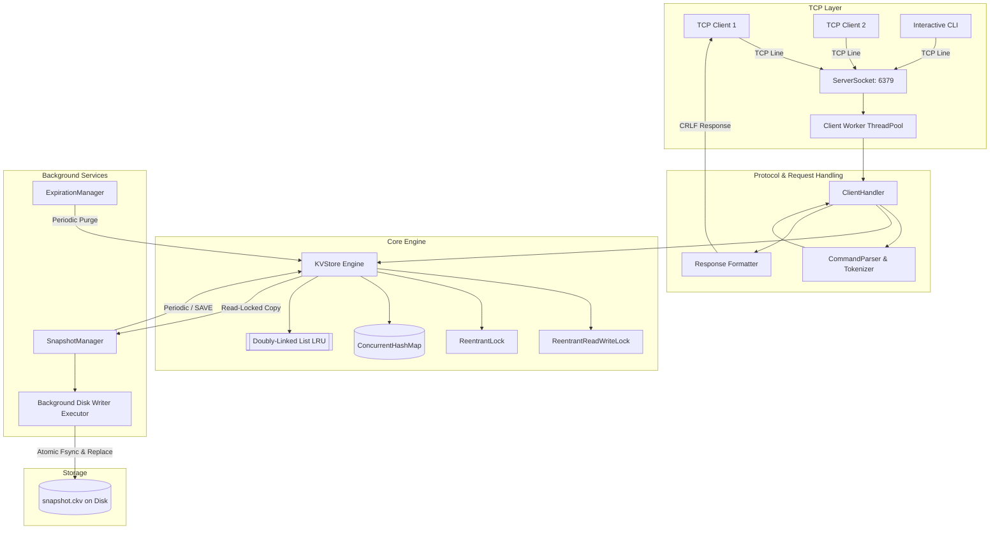
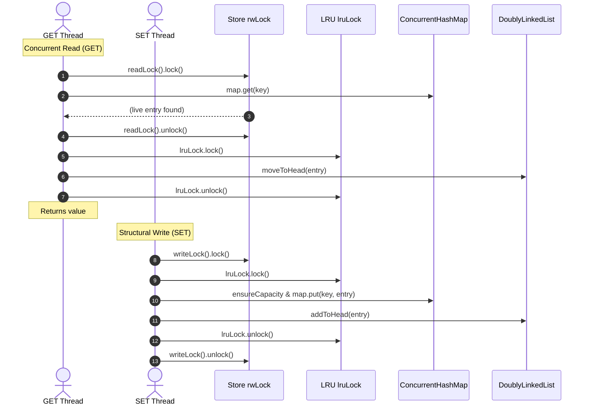

# ConcurrentKVStore - System Architecture

## 1. System Overview

**ConcurrentKVStore** is a lightweight, high-performance in-memory key-value database built from scratch in Java. It is inspired by Redis, employing a custom TCP text protocol, deterministic two-level locking for concurrency, an $O(1)$ Doubly-Linked-List LRU eviction cache, high-precision monotonic TTL expiration, and crash-resilient atomic snapshot persistence.



---

## 2. Layered Component Breakdown

### 2.1 Network & Protocol Layer (`com.concurrentkv.server`, `com.concurrentkv.protocol`)
- **`KVServer`**: Binds a `ServerSocket` to a configurable host and port. Limits maximum simultaneous client connections using an atomic counter and a bounded `ThreadPoolExecutor`.
- **`ClientHandler`**: Processes individual TCP sockets. Decodes lines using standard UTF-8 charset. Prevents unbounded memory growth by enforcing `maxLineLength` (default 64 KB).
- **`CommandParser`**: A custom lexical tokenizer that supports space-delimited tokens, double-quoted strings (`"..."`), single-quoted strings (`'...'`), and escape sequences (`\"`, `\\`, `\n`, `\t`). Validates argument counts and type constraints before execution.
- **`Response`**: Generates protocol responses conforming to line-based conventions terminated with `\r\n`.

### 2.2 Core Storage Engine (`com.concurrentkv.core`)
- **`KVStore`**: Coordinates data storage, thread synchronization, LRU eviction, and expiration.
- **`Entry`**: Encapsulates key, value, monotonic expiration timestamp (`expiryNanoTime`), wall-clock expiration epoch (`expiryEpochMs`), and doubly-linked list pointers (`prev`, `next`).
- **`DoublyLinkedList`**: A custom doubly-linked list with dummy `headSentinel` (MRU) and `tailSentinel` (LRU). Provides $O(1)$ operations for `addToHead`, `moveToHead`, `remove`, and `removeTail`.
- **`ExpirationManager`**: A background `ScheduledExecutorService` that periodically samples keys to reclaim expired memory without blocking user commands.

### 2.3 Persistence Layer (`com.concurrentkv.persistence`)
- **`SnapshotManager`**: Handles object-independent binary serialization to disk.
- Captures an immutable in-memory copy of live entries under a store read lock.
- Offloads file writing to a background single-thread executor to prevent blocking client requests.
- Atomically moves temporary files into place after verifying CRC32 checksums and issuing an OS `fsync`.

---

## 3. Concurrency Model & Locking Strategy

High concurrent throughput requires minimizing critical sections and avoiding reader-writer contention.

### Two-Level Locking Hierarchy
1. **Store Lock (`ReentrantReadWriteLock rwLock`)**:
   - `readLock()` is acquired by operations that do not modify store structure or values: `EXISTS`, `KEYS`, `DBSIZE`, `PTTL`, and `captureSnapshotEntries()`.
   - `writeLock()` is acquired by structural mutators: `SET`, `DEL`, `FLUSHALL`, and LRU eviction.
2. **LRU Lock (`ReentrantLock lruLock`)**:
   - Dedicated lock guarding the pointers (`prev`, `next`, `headSentinel`, `tailSentinel`) in `DoublyLinkedList`.



### Strict Deadlock Prevention Rule
> **Invariant**: If a thread ever requires both locks, it MUST acquire `rwLock` FIRST, and `lruLock` SECOND. It must release `lruLock` before releasing `rwLock`.
> 
> Because lock acquisition order is strictly monotonic ($rwLock \rightarrow lruLock$), circular wait conditions are mathematically impossible.

---

## 4. LRU Cache Mechanics

### Why ConcurrentHashMap alone is insufficient for LRU
`ConcurrentHashMap` provides bucket-level striping and thread-safe hash lookups, but it **maintains no recency order**.
LRU requires maintaining a total access ordering across all entries. When a key is read via `GET`, its recency must be refreshed. If multiple threads concurrently adjust node pointers in a linked list, pointers will be overwritten, resulting in detached nodes, broken links, or infinite pointer loops.
By combining `ConcurrentHashMap` for $O(1)$ key lookup with a synchronized `DoublyLinkedList`, ConcurrentKVStore achieves:
- $O(1)$ lookup
- $O(1)$ recency update
- $O(1)$ eviction of the least recently used key

---

## 5. TTL Expiration: Dual-Phase Architecture

To guarantee accuracy without sacrificing throughput, expiration employs a dual-phase approach:

1. **Passive / Lazy Expiration**:
   - Evaluated on every key access (`GET`, `EXISTS`, `PTTL`, `TTL`).
   - Uses monotonic clock: `(System.nanoTime() - expiryNanoTime) >= 0`.
   - If expired, the entry is immediately evicted and treated as non-existent.
   - Guarantees expired keys are **never returned to a client**.

2. **Active / Periodic Background Cleanup**:
   - Managed by `ExpirationManager` running on a daemon thread.
   - Periodically samples keys (default: 100 keys every 200ms).
   - Reclaims memory for keys that are never read again.
   - Safe deletion: Verifies that the entry being removed is the exact instance that expired, preventing race conditions where a newer value was concurrently installed under the same key.

---

## 6. Snapshot Persistence: Binary Format & Atomicity

### Binary File Structure (`.ckv`)
```
+-------------------------------------------------------------+
| MAGIC BYTES: 'C', 'K', 'V', 'S'                 [4 Bytes]   |
+-------------------------------------------------------------+
| FORMAT VERSION: 1                               [4 Bytes]   |
+-------------------------------------------------------------+
| SNAPSHOT TIMESTAMP (Epoch ms)                   [8 Bytes]   |
+-------------------------------------------------------------+
| RECORD COUNT: N                                 [4 Bytes]   |
+=============================================================+
| RECORD 1:                                                   |
|   - Key Length (int, 4 bytes)                               |
|   - Key UTF-8 bytes                                         |
|   - Value Length (int, 4 bytes)                             |
|   - Value UTF-8 bytes                                       |
|   - Has Expiry (boolean, 1 byte)                            |
|   - Expiry Epoch Ms (long, 8 bytes, if hasExpiry == true)   |
+-------------------------------------------------------------+
| ... [Records 2 through N]                                   |
+=============================================================+
| INTEGRITY CRC32 CHECKSUM                        [8 Bytes]   |
+-------------------------------------------------------------+
```

### Crash-Resilient Write Pipeline
1. **Consistent In-Memory Copy**: KVStore acquires `readLock`, copies live non-expired entries in LRU order, and releases `readLock`.
2. **Streaming Serialization**: The background executor streams records to a temporary file (`snapshot.ckv.tmp.<UUID>`) while calculating a CRC32 checksum in real-time.
3. **Hardware Flush (`fsync`)**: Calls `FileDescriptor.sync()` to force the OS kernel to flush its page buffer to non-volatile disk blocks.
4. **Atomic Rename**: Calls `Files.move(..., ATOMIC_MOVE, REPLACE_EXISTING)`. If the system crashes mid-write, the existing snapshot remains intact, and the incomplete temp file is discarded on next startup.
